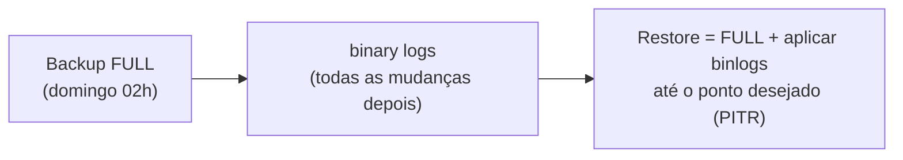

# MySQL Backup & Restore — Fundamentos e estratégia

A base para todo o resto da subpasta. Tipos de backup, o que escolher, e os conceitos (GTID, binlog, RPO/RTO) que fazem um restore **funcionar de verdade** na hora do desespero. Valores lidos do ambiente real do lab.

> Backup é o seguro mais crítico de um banco. **Um backup que nunca foi restaurado não é um backup — é uma esperança.** Teste restore com a mesma seriedade que faz backup.

---

## As duas perguntas que definem tudo: RPO e RTO

| Sigla | Pergunta | Exemplo |
|---|---|---|
| **RPO** (Recovery Point Objective) | "Quantos dados posso perder?" | RPO de 5 min = aceito perder até 5 min de transações |
| **RTO** (Recovery Time Objective) | "Quanto tempo posso ficar fora?" | RTO de 1 h = o banco tem que voltar em até 1 h |

Toda a estratégia (frequência de backup, tipo, se usa binlog) sai dessas duas respostas. **PITR** (point-in-time recovery) existe para chegar perto de RPO zero — ver doc próprio.

---

## Lógico × Físico

| | **Backup lógico** | **Backup físico** |
|---|---|---|
| O que é | `SQL`/dados exportados (`CREATE`, `INSERT`...) | Cópia dos **arquivos** do InnoDB (datadir) |
| Ferramentas | `mysqldump`, MySQL Shell (`util.dumpInstance`) | CLONE, Percona XtraBackup, cópia a frio |
| Velocidade (backup) | Mais lento em bases grandes | Rápido |
| Velocidade (restore) | **Lento** (reexecuta tudo) | **Rápido** (só copia arquivos) |
| Portabilidade | Alta (entre versões, seletivo por tabela) | Baixa (mesma versão/layout) |
| Granularidade | Uma tabela, um schema | Instância inteira |
| Tamanho | Menor (texto, comprime bem) | Maior (= datadir) |
| Quando brilha | Bases pequenas/médias, migração, recuperar 1 tabela | Bases grandes, restore rápido, clonar instância |

Regra prática: **base pequena/média ou preciso de uma tabela → lógico. Base grande ou preciso de restore rápido → físico.** Um ambiente maduro tem **os dois**.

- Backup lógico com `mysqldump`: `backup-restore-logico-mysqldump.md`
- Backup lógico com MySQL Shell (paralelo): `backup-restore-logico-mysql-shell.md`
- Backup físico (CLONE, XtraBackup, a frio): `backup-restore-fisico.md`

---

## Full, incremental e o papel do binary log

- **Full:** cópia completa. Simples, mas pesado de repetir toda hora.
- **Incremental:** só o que mudou desde o último backup (XtraBackup faz; reduz janela/espaço).
- **Binary log:** o registro de **toda alteração** (em ordem, com GTID). É o que permite "andar para frente" a partir de um full até um instante exato — a base do **PITR**.

Sem binlog arquivado, seu RPO é "desde o último full". Com binlog, o RPO cai para "segundos atrás".

---

## GTID: por que importa no backup

O ambiente do lab usa **GTID ligado** (`gtid_mode = ON`). GTID é o identificador único de cada transação. No backup/restore ele muda **duas** coisas:

1. **Rastreabilidade:** o backup guarda o conjunto de GTIDs que ele contém — você sabe exatamente até onde ele vai.
2. **A pegadinha do restore:** ao restaurar um dump **de volta no mesmo cluster vivo**, você **não** quer reimportar o estado de GTID (isso corrompe a replicação). Use `--set-gtid-purged=OFF`. Ao semear um **nó/cluster novo e vazio**, aí sim use `ON`/`AUTO`. (Detalhado no doc de mysqldump.)

---

## Onde e como rodar (boas práticas)

- **Rode o backup em um SECUNDÁRIO**, não no primário — não rouba recurso de quem atende a escrita.
- **Backup consistente:** use `--single-transaction` (lógico) ou ferramentas a quente (CLONE/XtraBackup). Nunca copie o datadir de um MySQL **ligado** sem ferramenta própria (arquivo inconsistente).
- **Teste o restore periodicamente.** Agende um "fire drill": restaure em uma instância de teste e confira contagens/integridade.
- **Monitore o binlog:** confirme `log_bin = ON` e uma retenção (`binlog_expire_logs_seconds`) **maior que o intervalo entre fulls** — senão o PITR fica sem as peças.

### A regra 3-2-1

> **3** cópias dos dados, em **2** mídias diferentes, com **1** cópia fora do local (offsite).

Backup no mesmo disco/host que pode falhar junto **não é** backup. Guarde cópias fora dos hosts do cluster.

---

## Ambiente de homologação (lido do lab)

| Item | Valor |
|---|---|
| MySQL Server | 9.7.4 |
| `log_bin` | ON |
| `binlog_format` | ROW |
| `gtid_mode` | ON |
| `binlog_expire_logs_seconds` | 2592000 (30 dias) |
| Plugin CLONE | ACTIVE |
| Percona XtraBackup | 9.7.1 (compatível com o server 9.7) |
| `datadir` | `/var/lib/mysql/` |

Topologia: InnoDB Cluster de 3 nós (ver subpasta `InnoDB-Cluster/`). Backups devem rodar preferencialmente em um secundário.

---

## Matriz de decisão rápida

| Situação | Caminho |
|---|---|
| Base pequena, quero portátil e seletivo | `mysqldump` (lógico) |
| Base média/grande, quero rápido e paralelo | MySQL Shell `util.dumpInstance` (lógico) |
| Base grande, restore tem que ser rápido | Físico (XtraBackup / CLONE) |
| Preciso voltar a um instante exato | Full + binlogs → **PITR** |
| Recriar/reparar um nó do cluster | CLONE (ver `InnoDB-Cluster/innodb-cluster-substituicao-no-clone.md`) |
| Recuperar **uma** tabela apagada | Lógico (restaura só ela em schema de teste) |

---

## Documentos desta subpasta

1. Fundamentos (este)
2. `backup-restore-logico-mysqldump.md`
3. `backup-restore-logico-mysql-shell.md`
4. `backup-restore-fisico.md`
5. `backup-restore-pitr.md`
