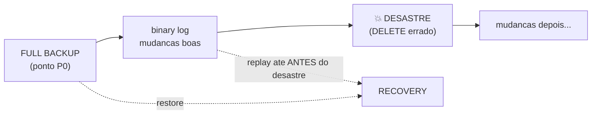

# MySQL Backup & Restore — Point-in-Time Recovery (PITR)

O backup mais poderoso: voltar o banco a **um instante exato** — por exemplo, o segundo **antes** de alguém rodar um `DELETE` sem `WHERE`. PITR = um backup full **+** os binary logs aplicados até o ponto escolhido. Demonstrado de ponta a ponta no lab, desfazendo um desastre real.

> Pré-leitura: `backup-restore-fundamentos.md` e `backup-restore-logico-mysqldump.md`.

---

## A ideia



Você restaura o full (volta ao passado) e depois **reaplica o binlog** até o instante **imediatamente anterior** ao desastre. O que veio depois (o `DELETE`) **não** é aplicado.

**Pré-requisitos:**
- `log_bin = ON` (lab: ON) e binlogs **retidos** (lab: 30 dias).
- Um **full backup** com a coordenada de binlog registrada (`mysqldump --source-data=2` ou `xtrabackup_binlog_info`).
- Os binlogs do intervalo entre o full e o desastre.

---

## O experimento (executado no lab)

Schema `loja`, tabela `estoque`. Linha do tempo real:

### 1. Estado inicial (S0) e full backup

```
S0 = 3 linhas: (1,Teclado,100) (2,Mouse,200) (3,Monitor,50)

mysqldump --single-transaction --source-data=2 --set-gtid-purged=OFF --databases loja > loja_full.sql
-> P0 = binlog.000007 : 21305      (coordenada guardada pelo --source-data=2)
```

### 2. Mudanças boas (S1) e a marca do "antes do desastre"

```sql
INSERT INTO loja.estoque VALUES (4,'Webcam',30);
UPDATE loja.estoque SET qtd=qtd+10 WHERE id=1;      -- Teclado 100 -> 110
```

Capture a posição **atual** do binlog (o ponto até onde queremos recuperar):

```sql
SHOW BINARY LOG STATUS;    -- (use mysql -E para ler File:/Position: limpo)
-> STOP = binlog.000007 : 21945
```

Estado S1 = **4 linhas** (Teclado 110, +Webcam).

### 3. 💥 O desastre

```sql
DELETE FROM loja.estoque;     -- sem WHERE: apaga tudo
-> linhas = 0
```

### 4. Recovery em 2 passos

**Passo 1 — restaurar o full (volta a S0):**

```bash
mysql < loja_full.sql
-> linhas = 3   (S0 de volta, mas perdemos as mudancas boas... ainda)
```

**Passo 2 — reaplicar o binlog de P0 até ANTES do desastre:**

```bash
mysqlbinlog --skip-gtids --database=loja \
  --start-position=21305 --stop-position=21945 \
  /var/lib/mysql/binlog.000007 | mysql
```

### 5. Resultado — desastre desfeito

Saída **real** do estado recuperado:

```
+----+---------+------+
| id | produto | qtd  |
+----+---------+------+
|  1 | Teclado |  110 |     <- a mudanca boa (UPDATE) voltou
|  2 | Mouse   |  200 |
|  3 | Monitor |   50 |
|  4 | Webcam  |   30 |     <- o INSERT bom voltou
+----+---------+------+
```

Recuperamos **exatamente o S1** (o instante antes do `DELETE`). O desastre não foi aplicado, e **nenhuma** das mudanças boas se perdeu. Isso é PITR.

---

## As opções que importam no `mysqlbinlog`

| Opção | O que faz |
|---|---|
| `--start-position` | De onde começar (a coordenada P0 do full backup) |
| `--stop-position` | Onde parar (o ponto **antes** do desastre) |
| `--stop-datetime='2026-11-11 21:00:00'` | Parar por **data/hora** em vez de posição |
| `--start-datetime` | Começar por data/hora |
| `--database=loja` | Aplicar só os eventos daquele schema |
| `--skip-gtids` | **Crucial** com GTID ligado (ver abaixo) |

Parar por **posição** é mais preciso; por **datetime** é mais intuitivo quando você sabe a hora do incidente mas não a posição.

---

## A pegadinha do GTID (por que `--skip-gtids`)

Com `gtid_mode = ON`, cada transação tem um GTID único, e o servidor **ignora** transações cujo GTID ele já executou. Se você reaplicar binlogs cujos GTIDs já estão no `gtid_executed`, eles são **pulados** — e o replay "não faz nada".

- `--skip-gtids` remove a informação de GTID dos eventos, fazendo-os aplicar como transações **novas**. É o que usamos.
- **Melhor prática de produção:** faça o PITR em uma **instância separada e vazia** (gtid_executed limpo), onde não há dedup. Lá você restaura o full e aplica os binlogs sem `--skip-gtids`, de forma natural. Depois promove essa instância ou extrai os dados recuperados.

---

## Como achar o ponto do desastre na vida real

Você raramente sabe a posição de cor. Inspecione o binlog para localizar o evento ruim:

```bash
# Ler o binlog em texto e procurar o comando catastrofico
sudo mysqlbinlog --database=loja /var/lib/mysql/binlog.000007 | grep -n -i "DELETE"

# Ou listar eventos com posicao e horario
sudo mysqlbinlog -v /var/lib/mysql/binlog.000007 | grep -E "^# at |end_log_pos|DELETE"
```

Ache a **posição imediatamente anterior** ao `DELETE` (o `# at <pos>` do evento ruim) e use como `--stop-position`. Em `binlog_format=ROW` (o caso do lab) o `DELETE` não aparece como SQL legível; use `-v`/`--base64-output=DECODE-ROWS` para ver as linhas afetadas, ou pare por `--stop-datetime`.

---

## Fluxo de produção (resumo)

1. **Full backup** regular (lógico ou físico), guardando a coordenada/GTID.
2. **Binlogs** retidos e copiados para fora do host.
3. No incidente: identifique a hora/posição do erro.
4. Restaure o **último full anterior** ao erro (de preferência numa instância limpa).
5. Aplique os **binlogs** do ponto do full até **antes** do erro.
6. Valide os dados e promova/extraia.

> RPO do PITR ≈ o atraso entre o último binlog seguro e o incidente — tipicamente segundos. É o que mais se aproxima de "não perder nada".

---

## Comandos úteis

```bash
# Coordenada do full (mysqldump)
grep -i 'CHANGE REPLICATION SOURCE' loja_full.sql

# Ponto atual do binlog
mysql -E -e "SHOW BINARY LOG STATUS"      # le File: e Position:

# Replay ate uma posicao
mysqlbinlog --skip-gtids --database=<db> --start-position=<P0> --stop-position=<Pstop> \
  /var/lib/mysql/binlog.0000NN | mysql

# Replay ate uma data/hora
mysqlbinlog --skip-gtids --stop-datetime='2026-11-11 21:00:00' \
  /var/lib/mysql/binlog.0000NN | mysql
```

> Se o intervalo cruzar **vários** arquivos de binlog, passe-os em ordem na mesma linha (`binlog.000007 binlog.000008`), com `--start-position` valendo para o primeiro e `--stop-position`/`--stop-datetime` para o último.

---

## Não incluído neste documento

- PITR em instância separada passo a passo (provisionar, aplicar, promover).
- PITR a partir de backup **físico** (XtraBackup `xtrabackup_binlog_info` como P0).
- Recuperação seletiva de uma única tabela a partir do binlog.
