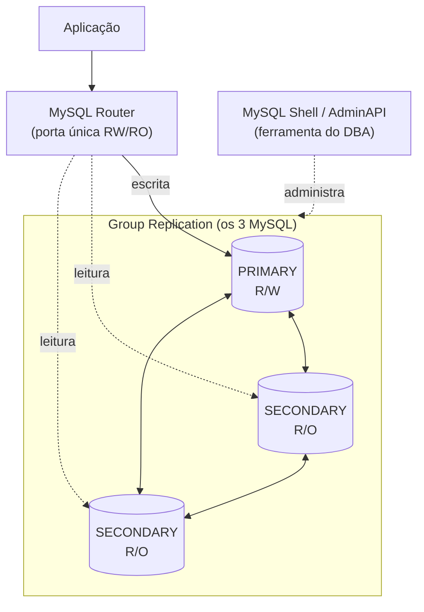

# MySQL InnoDB Cluster — Fundamentos de Alta Disponibilidade

Documento **conceitual** para quem vai operar o cluster sem ter montado ele. Explica *por que* as coisas funcionam, para que os runbooks (recuperação, failover, quórum) façam sentido. Os números e variáveis aqui foram lidos do cluster real do lab.

> Pré-leitura: `InnoDB-Cluster/innodb-cluster-single-primary-router.md` (instalação e topologia).

---

## O que "alta disponibilidade" significa aqui

Objetivo prático: **se um nó cair, a aplicação continua escrevendo e lendo, sozinha, sem ninguém de madrugada mexer em string de conexão.** No nosso desenho (3 nós, Single-Primary), o cluster tolera a perda de **1 nó** sem parar.

Isso é entregue por **três peças que trabalham juntas**:



| Peça | Papel | Quem usa |
|---|---|---|
| **Group Replication (GR)** | Replica os dados entre os 3 MySQL e decide, por votação, quem pode escrever. É o "coração" da HA. | O próprio MySQL, automático |
| **MySQL Shell (AdminAPI)** | Cria, inspeciona e conserta o cluster (`dba.*`, `cluster.*`). Não fica no caminho da aplicação. | O DBA |
| **MySQL Router** | Porta única para a aplicação. Descobre sozinho quem é o PRIMARY e redireciona escrita/leitura. | A aplicação |

Separe bem: **GR mantém os dados em pé; o Router mantém a aplicação conectada no nó certo; o Shell é a ferramenta de quem administra.** Falha de uma peça não é igual à da outra.

---

## Group Replication em miúdos

Os três MySQL formam um **grupo**. Toda transação de escrita passa por um acordo entre a maioria dos membros antes de ser confirmada (um protocolo de consenso, da família Paxos). Isso garante que **todos concordam com a mesma ordem de transações** — é o que evita dois nós divergirem.

Dois conceitos que você vai repetir a vida toda:

### GTID — o "número de série" de cada transação

Cada transação ganha um identificador único e global, o **GTID** (Global Transaction ID), no formato `uuid:número`. Exemplo real do lab:

```
ada394af-d965-11f1-a550-0800279d6d5f:1-97
```

Isso quer dizer "deste servidor de origem, já apliquei as transações 1 até 97". Comparando os conjuntos de GTID de dois nós, você sabe **quem está mais à frente** e **quem está atrasado** — sem olhar os dados. É por isso que:
- O GR consegue reconectar um nó atrasado aplicando só o que falta (*incremental recovery*).
- Na recuperação de queda total, você escolhe como semente o nó com o maior conjunto de GTID.

Pré-requisito (já ligado na instalação): `gtid_mode = ON` e `enforce_gtid_consistency = ON`.

### Quórum — maioria manda

O grupo só aceita escrita se a **maioria** dos membros está viva e se enxergando. Isso evita *split-brain* (duas metades achando que cada uma é a dona).

| Nós no cluster | Maioria (quórum) | Falhas toleradas |
|---|---|---|
| 1 | 1 | 0 |
| **3** (nosso caso) | **2** | **1** |
| 5 | 3 | 2 |
| 7 | 4 | 3 |

Fórmula: com `N` nós, tolera-se perder `floor((N-1)/2)`. Por isso se usa **número ímpar** de nós — 4 nós toleram a mesma coisa que 3 (1 falha), mas com mais custo. Perdeu a maioria? O cluster **congela a escrita** de propósito, à espera de intervenção (é a "perda de quórum").

---

## Single-Primary: papéis e quem pode escrever

Rodamos em **Single-Primary** (lido do cluster: `@@group_replication_single_primary_mode = 1`). Isso significa:

- **Um** nó é o **PRIMARY**: aceita escrita e leitura (`R/W`, `read_only = 0`).
- Os demais são **SECONDARY**: só leitura (`R/O`). O MySQL os protege com `super_read_only = 1` — nem um usuário com privilégio alto escreve por engano.

Estado real do lab:

```
+-------------+--------+-----------+---------+
| host        | state  | role      | version |
+-------------+--------+-----------+---------+
| mysql-db-01 | ONLINE | PRIMARY   | 9.7.4   |
| mysql-db-02 | ONLINE | SECONDARY | 9.7.4   |
| mysql-db-03 | ONLINE | SECONDARY | 9.7.4   |
+-------------+--------+-----------+---------+
```

> Existe também o modo **Multi-Primary** (vários nós escrevem). Não usamos — exige a aplicação tratar conflitos de escrita. Fique no Single-Primary a menos que haja um motivo forte.

### Estados de um membro

Você vai ver estes valores em `member_state`:

| Estado | Significado |
|---|---|
| `ONLINE` | Membro saudável, participando do grupo. |
| `RECOVERING` | Entrou agora e está se sincronizando (aplicando GTIDs ou clonando). Normal e temporário. |
| `OFFLINE` | O `mysqld` está de pé, mas **não** está no grupo. Típico de queda total. |
| `UNREACHABLE` | Os outros não conseguem falar com ele (rede/queda). Candidato a ser expulso. |
| `ERROR` | Deu problema ao aplicar/entrar. Precisa de análise (log de erro). |

---

## Failover × Switchover (não confunda)

Os dois trocam quem é o PRIMARY, mas a origem é oposta:

| | **Failover** | **Switchover** |
|---|---|---|
| Quando | O PRIMARY **caiu** (não planejado) | Você **decide** trocar (planejado) |
| Quem dispara | O próprio GR, **automático** | O DBA, com `cluster.setPrimaryInstance()` |
| Perda de serviço | Segundos (eleição + Router reconverge) | Praticamente zero |
| Risco de dados | Protegido pela consistência (abaixo) | Nenhum |

Quando o PRIMARY cai, os secundários **elegem** um novo PRIMARY automaticamente (quem estiver mais à frente em GTID tem preferência). O Router percebe e passa a mandar a escrita para o novo PRIMARY — **sem trocar a string de conexão da aplicação**. Isso é o failover, detalhado no runbook próprio.

### Consistência no failover

O lab está com `@@group_replication_consistency = BEFORE_ON_PRIMARY_FAILOVER`. Em português: **durante um failover, o novo PRIMARY só aceita operações depois de terminar de aplicar tudo que estava pendente.** Isso evita a aplicação ler um dado "velho" logo após a troca. É um bom padrão para quem precisa de leitura consistente pós-failover.

### Auto-rejoin

`@@group_replication_autorejoin_tries = 3`: se um nó for expulso por uma falha passageira (ex.: travada de rede), ele **tenta voltar sozinho** até 3 vezes antes de desistir. Reduz a necessidade de intervenção manual em soluços de rede.

---

## O MySQL Router: por que a aplicação não precisa saber quem é o PRIMARY

A aplicação conecta **sempre no mesmo endereço** (o Router) e nas portas fixas:

| Porta | Uso | Para onde manda |
|---|---|---|
| 6446 | Clássico **RW** (escrita) | Sempre o **PRIMARY** atual |
| 6447 | Clássico **RO** (leitura) | Distribui entre os **SECONDARY** |
| 6450 | **RW Split** | Separa leitura/escrita na mesma conexão |
| 6448 / 6449 | X Protocol RW / RO | Equivalente para o protocolo X |

O Router **lê o metadata do cluster** (mantido pelo AdminAPI) e acompanha o GR em tempo real. Quando o PRIMARY muda (failover/switchover), o Router reaprende em segundos e redireciona. Por isso a aplicação sobrevive a uma troca de PRIMARY sem nem saber que houve.

> Atenção de produção: um Router único é ponto único de falha. Em produção, rode **mais de um Router** (ou junto de cada aplicação) atrás de um VIP/balanceador. Tema de runbook próprio.

---

## Glossário rápido

- **AdminAPI**: conjunto de comandos do MySQL Shell (`dba.*`, `cluster.*`) para administrar o cluster.
- **Clone**: provisionamento que **sobrescreve** um nó com um snapshot físico de outro. Usado quando o nó está muito atrás.
- **Incremental recovery**: sincroniza um nó aplicando só os GTIDs que faltam. Rápido.
- **Quórum**: maioria de membros necessária para o cluster operar escrita.
- **Split-brain**: duas partes do cluster escrevendo em paralelo, gerando divergência. É o que o quórum previne.
- **super_read_only**: trava de escrita mais forte que `read_only`, aplicada nos secundários — bloqueia até usuários privilegiados.

---

## Para onde ir depois

- Recuperação de queda total: `innodb-cluster-recuperacao-queda-total.md`
- Failover e switchover (runbook): `innodb-cluster-failover-switchover.md`
- Perda de quórum (runbook): `innodb-cluster-perda-de-quorum.md`
- Monitoração e healthcheck: `innodb-cluster-monitoracao-healthcheck.md`
