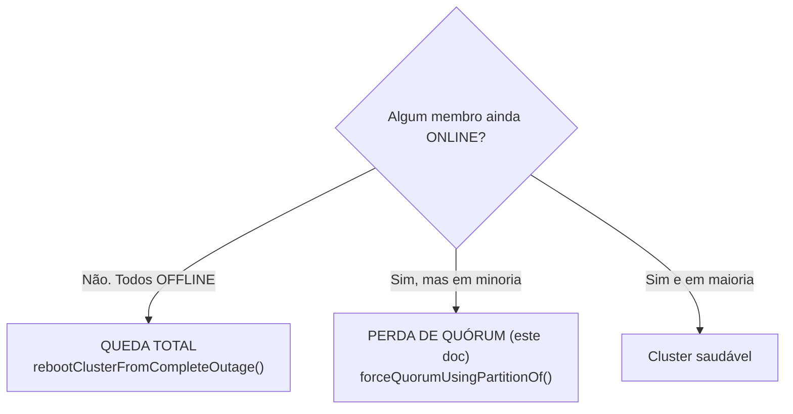

# MySQL InnoDB Cluster — Perda de quórum (NO_QUORUM)

Runbook para quando a **maioria** dos nós caiu de forma abrupta e o cluster **congelou a escrita** para se proteger. A ferramenta é `forceQuorumUsingPartitionOf()`. Inclui simulação executada no lab com saída real.

> ⚠️ Este é o runbook mais perigoso da série. `forceQuorumUsingPartitionOf()` pode causar **split-brain** e perda de dados se usado errado. Leia a seção *Quando NÃO usar* antes de digitar o comando.

> Pré-leitura: `innodb-cluster-fundamentos-alta-disponibilidade.md` (quórum) e o fluxograma em `innodb-cluster-recuperacao-queda-total.md` (queda total × perda de quórum).

---

## O que é perda de quórum (e a diferença para queda total)

Lembre do fluxograma:



**Perda de quórum** = parte do cluster ainda está `ONLINE`, mas é **minoria** (ex.: 1 de 3). Como não há maioria, o Group Replication **bloqueia a escrita de propósito** — ele prefere parar a arriscar dois lados divergirem (*split-brain*). Os nós sobreviventes enxergam os caídos como `UNREACHABLE`.

Isso acontece quando a maioria cai **abruptamente** (crash, queda de energia, partição de rede) — não dá tempo de uma saída graciosa. Uma parada limpa (`systemctl stop`) **não** causa isso: ela encolhe o grupo de forma ordenada.

---

## Diagnóstico: confirme que é perda de quórum

Em um nó sobrevivente, via socket local:

```bash
sudo mysql -t -e "SELECT member_host, member_state FROM performance_schema.replication_group_members;"
```

Saída real do lab (db-01 sobreviveu; db-02 e db-03 caíram):

```
+-------------+--------------+
| member_host | member_state |
+-------------+--------------+
| mysql-db-02 | UNREACHABLE  |
| mysql-db-01 | ONLINE       |
| mysql-db-03 | UNREACHABLE  |
+-------------+--------------+
```

**Como ler:**
- Há **pelo menos um** `ONLINE` (por isso **não** é queda total).
- A maioria está `UNREACHABLE` → sem quórum.

O sintoma do lado da aplicação é traiçoeiro:

```
sudo mysql -t -e "SELECT @@hostname,@@read_only,@@super_read_only;"
+-------------+------+------+
| host        | ro   | sro  |
+-------------+------+------+
| mysql-db-01 |    0 |    0 |   <- parece gravável (read_only=0)...
+-------------+------+------+
```

Repare: o sobrevivente que **era** PRIMARY continua com `read_only = 0`. Mas qualquer escrita **trava** (fica pendurada esperando a maioria), ela **não** volta com erro imediato. No lab, o `INSERT` pela porta 6446 do Router **pendurou até o `timeout` matar a conexão**. Esse é o retrato clássico: "o banco parou de responder escrita, mas não dá erro".

> Regra de bolso: aplicação com escrita travando + `member_state` mostrando `UNREACHABLE` na maioria = perda de quórum.

---

## Quando NÃO usar `forceQuorumUsingPartitionOf()`

Este comando diz ao cluster: *"ignore os membros que sumiram e siga com esta partição aqui"*. Se os membros "sumidos" **na verdade estão vivos** (foi só a rede entre vocês que caiu — uma *partição de rede*), você vai acabar com **dois cluster independentes aceitando escrita** = split-brain = dados divergentes, dor de cabeça enorme para reconciliar.

**Só use se você tem CERTEZA de que a maioria está realmente morta** (hosts desligados, processos derrubados, não apenas "não respondem à minha máquina"). Se a dúvida é rede, **primeiro** confirme que os outros nós estão de fato fora (acesse cada host, veja o `mysqld`). Na dúvida, **espere** — se for soluço de rede, o cluster se recompõe sozinho quando a conectividade volta.

---

## Passo 1: forçar o quórum a partir da partição boa

Rode o Shell apontando para um nó sobrevivente e force o quórum usando a partição dele:

```bash
mysqlsh --uri clusteradmin@mysql-db-01:3306 --js \
  --execute="dba.getCluster().forceQuorumUsingPartitionOf('clusteradmin@mysql-db-01:3306')"
```

Saída **real** do lab:

```
WARNING: Cluster has no quorum and cannot process write transactions: Group has no quorum
Retrying getCluster() using a secondary member
Restoring cluster 'labCluster' from loss of quorum, by using the partition composed of [mysql-db-01:3306]
Restoring the InnoDB cluster ...
The InnoDB cluster was successfully restored using the partition from the instance 'clusteradmin@mysql-db-01:3306'.
WARNING: To avoid a split-brain scenario, ensure that all other members of the cluster are
         removed or joined back to the group that was restored.
```

Depois, o grupo passa a ter só o sobrevivente:

```
+-------------+--------------+
| member_host | member_state |
+-------------+--------------+
| mysql-db-01 | ONLINE       |
+-------------+--------------+
```

Nesse ponto o cluster **volta a aceitar escrita** com um único membro (quórum = 1). A `WARNING` final é séria: garanta que os outros nós **voltem para este grupo** (Passo 2) e não subam formando um grupo à parte.

> Observação do lab: a escrita que havia ficado **pendurada** durante o NO_QUORUM foi **aplicada** assim que o quórum voltou (a linha não se perdeu). Ou seja, transações bloqueadas ficam na fila, não são descartadas — mais um motivo para ter certeza antes de forçar.

---

## Passo 2: trazer os nós de volta

Religue o MySQL nos nós que caíram:

```bash
sudo systemctl start mysql     # em cada nó que caiu
```

Com `group_replication_start_on_boot = ON` (padrão do cluster), cada nó **rejunta sozinho** à partição restaurada. Espere ~30s e valide:

```bash
mysqlsh --uri clusteradmin@mysql-db-01:3306 --js \
  --execute="print(JSON.stringify(dba.getCluster().status().defaultReplicaSet, null, 2))"
```

Saída real após o retorno:

```
status = OK
mysql-db-01:3306   role=PRIMARY     status=ONLINE
mysql-db-02:3306   role=SECONDARY   status=ONLINE
mysql-db-03:3306   role=SECONDARY   status=ONLINE
```

Se algum nó **não** rejuntar sozinho (ficar `(MISSING)`/`OFFLINE`):

```bash
mysqlsh --uri clusteradmin@mysql-db-01:3306 --js \
  --execute="dba.getCluster().rejoinInstance('clusteradmin@mysql-db-02:3306')"
# ou, se o metadata estiver desatualizado:
mysqlsh --uri clusteradmin@mysql-db-01:3306 --js --execute="dba.getCluster().rescan()"
```

---

## Checklist final

1. `member_state` só com `ONLINE` (nenhum `UNREACHABLE`).
2. `dba.getCluster().status()` → `status = OK`.
3. Escrita pela 6446 volta a responder **na hora** (sem pendurar).
4. Nenhum nó subiu formando um grupo separado (sem split-brain).

---

## Se já houve split-brain (dois lados escreveram)

Se você forçou o quórum de um lado e o outro lado também ficou gravável, há divergência. Não existe "desfazer" mágico:
- Escolha o lado **autoritativo** (o que tem os dados que valem).
- Nos outros nós, refaça a entrada no cluster **com `clone`** (sobrescreve o nó com o estado do autoritativo): `cluster.rejoinInstance('clusteradmin@<nó>:3306', {recoveryMethod:'clone'})` ou remova e readicione.
- Se houve escrita conflitante relevante dos dois lados, é caso de análise manual / restore de backup. Por isso a seção *Quando NÃO usar* existe.

---

## Comandos úteis

```bash
# Diagnóstico (em um sobrevivente)
sudo mysql -t -e "SELECT member_host, member_state FROM performance_schema.replication_group_members;"

# Forçar quórum pela partição boa
mysqlsh --uri clusteradmin@mysql-db-01:3306 --js \
  --execute="dba.getCluster().forceQuorumUsingPartitionOf('clusteradmin@mysql-db-01:3306')"

# Trazer nós de volta
sudo systemctl start mysql      # em cada nó caído
mysqlsh --uri clusteradmin@mysql-db-01:3306 --js --execute="dba.getCluster().rescan()"
```

---

## Não incluído neste documento

- Reconciliação de dados após split-brain consumado (depende de backup/análise caso a caso).
- Perda de quórum causada por partição de rede prolongada (ajustes de `group_replication_unreachable_majority_timeout`).
- Queda total (todos OFFLINE) — `innodb-cluster-recuperacao-queda-total.md`.
