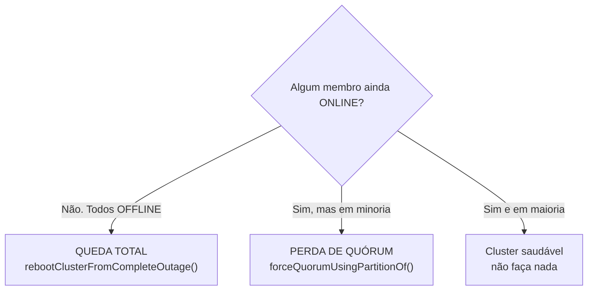

# MySQL InnoDB Cluster — Recuperação de queda total (Complete Outage)

Runbook para quando o cluster inteiro caiu: os três MySQL estão de pé, mas o Group Replication parou em todos e **não existe PRIMARY**. É o cenário resolvido por `dba.rebootClusterFromCompleteOutage()`.

Procedimento **executado e validado em laboratório** (os mesmos 3 nós do documento de instalação). Cada saída deste runbook é saída real da execução. Siga na ordem.

> Pré-leitura recomendada: `InnoDB-Cluster/innodb-cluster-single-primary-router.md` (instalação, topologia e os servidores do lab).

---

## O que é "queda total" (e o que NÃO é)

Em um InnoDB Cluster Single-Primary, a decisão de quem pode escrever depende de **quórum** (maioria dos membros se enxergando). A partir daí há dois cenários de falha muito diferentes, e **cada um tem uma ferramenta diferente**. Confundir os dois é o erro mais comum.

| Situação | O que você vê | Ferramenta correta |
|---|---|---|
| **Queda total** (este runbook) | **Nenhum** membro `ONLINE`. Todos os nós `OFFLINE`, todos `read_only`. `dba.getCluster()` falha dizendo que não há cluster operacional. | `dba.rebootClusterFromCompleteOutage()` |
| **Perda de quórum** | Alguns nós **ainda** `ONLINE`, mas em minoria (ex.: 1 de 3). O cluster fica travado, sem escrever, status `NO_QUORUM`. | `cluster.forceQuorumUsingPartitionOf()` (outro runbook) |



**Regra de ouro:** só use `rebootClusterFromCompleteOutage()` quando **nenhum** nó estiver `ONLINE`. Se ainda houver membro `ONLINE`, você tem perda de quórum, não queda total — pare e use o runbook de quórum.

### Por que a queda total acontece

- Desligamento do ambiente inteiro (manutenção, falta de energia, host da VM reiniciado) sem subida ordenada depois.
- Todos os nós reiniciaram "ao mesmo tempo" e nenhum foi configurado para religar o Group Replication sozinho na queda total (o GR, por segurança, **não** forma grupo automaticamente após uma queda total — para evitar *split-brain*, ele espera uma decisão humana).
- Perda de quórum que evoluiu até o último nó sair.

Nesses casos os `mysqld` sobem normalmente, mas ficam todos como `OFFLINE`/`super_read_only`, à espera de alguém dizer "este é o ponto de partida".

---

## Diagnóstico: confirme que é queda total

Rode estas checagens **antes** de qualquer ação. O objetivo é provar duas coisas: (1) os MySQL estão de pé e (2) o grupo está parado em todos.

### 1. Os três `mysqld` estão vivos?

```bash
for n in mysql-db-01 mysql-db-02 mysql-db-03; do
  echo -n "$n: "; ssh dba@$n "systemctl is-active mysql"
done
```

Resultado esperado: `active` nos três. Se algum estiver `inactive`, suba com `sudo systemctl start mysql` antes de prosseguir.

### 2. O grupo está parado e todos estão `read_only`?

Rodando o cliente local em cada nó (acesso root pelo socket, via `sudo`):

```bash
sudo mysql -N -e "SELECT @@hostname, @@read_only, @@super_read_only;"
sudo mysql -N -e "SELECT member_host, member_state, member_role FROM performance_schema.replication_group_members;"
```

Saída real observada no lab, nos três nós:

```
mysql-db-01   1   1        <- read_only = super_read_only = 1
mysql-db-01   OFFLINE      <- cada nó só enxerga a si mesmo, e OFFLINE
```

**Como ler isto:**
- `read_only = 1` e `super_read_only = 1` em **todos** = ninguém é PRIMARY.
- Cada nó lista **apenas a si mesmo** como `OFFLINE` em `replication_group_members` = o grupo não está formado. (Num cluster saudável, cada nó listaria os três como `ONLINE`.)

O plugin em si continua carregado — isso é normal e não significa que o grupo está rodando:

```bash
sudo mysql -N -e "SELECT plugin_status FROM information_schema.plugins WHERE plugin_name='group_replication';"
# ACTIVE  <- plugin carregado, mas o grupo está parado. Não confunda.
```

### 3. Confirme pelo AdminAPI (opcional, mas recomendado)

```bash
mysqlsh --uri clusteradmin@mysql-db-01:3306 --js --execute="dba.getCluster()"
```

Em queda total isso **falha** com uma mensagem do tipo *"Unable to connect to the ONLINE members of the cluster"* / *"cluster is not operational"*. Essa falha é a confirmação final: não há grupo para pegar.

---

## Passo 1: escolher o nó "semente" (seed)

A recuperação parte de **um** nó, que vira o ponto de verdade; os outros se juntam a ele. O nó semente deve ser o **mais atualizado** (o que aplicou mais transações). Quem tiver o maior `gtid_executed` não corre risco de perder dados.

```bash
for n in mysql-db-01 mysql-db-02 mysql-db-03; do
  echo "== $n =="; ssh dba@$n "sudo mysql -N -e \"SELECT @@gtid_executed\\G\""
done
```

Saída real do lab (resumida) — os três idênticos:

```
ada394af-...:1-97:1000001-1000449:mysqlsh:1-86, f5ee7067-...:mysqlsh:1-4
```

**Como decidir:**
- Se os `gtid_executed` forem **iguais** (como aqui), qualquer nó serve. Use o PRIMARY original (`mysql-db-01`) por convenção.
- Se forem **diferentes**, escolha o nó cujo conjunto GTID **contém** os dos outros (o "superconjunto"). Esse é o mais à frente.
- Versões recentes do Shell também detectam o nó mais atualizado sozinhas e avisam se você conectar no nó errado — mas confirmar na mão é boa prática de júnior/estagiário.

> GTID em uma frase: é o "número de série" único de cada transação. Comparando os conjuntos, você sabe quem tem mais história aplicada — logo, quem pode ser a fonte sem perder nada.

---

## Passo 2: executar o reboot a partir do seed

Conecte o Shell ao seed e dispare o reboot. O comando religa o grupo no seed e **rejunta os demais automaticamente**.

```bash
mysqlsh --uri clusteradmin@mysql-db-01:3306 --js \
  --execute="dba.rebootClusterFromCompleteOutage()"
```

Saída **real** da execução no lab (trechos-chave):

```
Restoring the Cluster 'labCluster' from complete outage...
Cluster instances: 'mysql-db-01:3306' (OFFLINE), 'mysql-db-02:3306' (OFFLINE), 'mysql-db-03:3306' (OFFLINE)
Waiting for instances to apply pending received transactions...
Validating instance configuration at mysql-db-01:3306...
Instance configuration is suitable.
* Waiting for seed instance to become ONLINE...
mysql-db-01:3306 was restored.
...
Incremental state recovery was selected because it seems to be safely usable.
Rejoining instance 'mysql-db-02:3306' to cluster 'labCluster'...
The instance 'mysql-db-02:3306' was successfully rejoined to the cluster.
...
Rejoining instance 'mysql-db-03:3306' to cluster 'labCluster'...
The instance 'mysql-db-03:3306' was successfully rejoined to the cluster.
The Cluster was successfully rebooted.
```

**O que aconteceu, em português:**
1. O Shell olhou os três, viu todos `OFFLINE` e confirmou que é queda total.
2. Esperou cada nó terminar de aplicar transações já recebidas (para não religar "pela metade").
3. Elegeu o `mysql-db-01` como seed e o colocou `ONLINE` como PRIMARY.
4. Para cada secundário, escolheu o método de recuperação:
   - **`Incremental`** (escolhido aqui): o nó só precisava repor poucas transações via GTID. Rápido, sem copiar o banco inteiro.
   - **`Clone`**: usado quando o nó está muito atrás ou tem dados incompatíveis — apaga o datadir e copia um snapshot físico do seed. É o que o `addInstance(..., {recoveryMethod:'clone'})` faz na instalação.
5. Rejuntou db-02 e db-03 e declarou o cluster de volta.

### Se o comando parar para perguntar algo

Dependendo da versão/estado, o reboot pode fazer perguntas interativas (ex.: "rejuntar a instância X? [y/N]"). Em execução **não interativa** (com `--execute=`), ele assume os padrões seguros e rejunta os nós acessíveis — foi o que ocorreu aqui. Se você rodar o Shell interativo (`mysqlsh` e depois os comandos), responda `y` para rejuntar os nós que você reconhece como válidos.

---

## Passo 3: validar o cluster

```bash
mysqlsh --uri clusteradmin@mysql-db-01:3306 --js \
  --execute="print(JSON.stringify(dba.getCluster().status(), null, 2))"
```

Resultado esperado (resumo real do lab):

```
status = OK | primary = mysql-db-01:3306
mysql-db-01:3306   role=PRIMARY     mode=R/W   status=ONLINE
mysql-db-02:3306   role=SECONDARY   mode=R/O   status=ONLINE
mysql-db-03:3306   role=SECONDARY   mode=R/O   status=ONLINE
```

Checklist de "voltou mesmo":
- `status` do replicaset = `OK` (ou `OK_NO_TOLERANCE` se um nó ainda não voltou, mas aí não é mais queda total).
- Exatamente **um** PRIMARY `R/W`.
- Todos os membros `ONLINE`, sem `instanceErrors`.

---

## Passo 4: validar o Router (prova de que a aplicação voltou)

O cluster pode estar `OK` e a aplicação ainda falhar se o Router não estiver roteando. Teste as duas portas:

```bash
# Porta de escrita (RW) -> tem que cair no PRIMARY, read_only = 0
mysql -h 127.0.0.1 -P 6446 -u <app> -p -N -e "SELECT @@hostname, @@read_only;"

# Porta de leitura (RO) -> alterna entre os secundários, read_only = 1
for i in 1 2 3; do mysql -h 127.0.0.1 -P 6447 -u <app> -p -N -e "SELECT @@hostname, @@read_only;"; done
```

Resultado esperado (real no lab):

```
6446 (RW) ->  mysql-db-01   0
6447 (RO) ->  mysql-db-02   1
              mysql-db-03   1
              mysql-db-02   1
```

Se a **6446** responde o PRIMARY com `read_only = 0` e a **6447** alterna os secundários com `read_only = 1`, a camada de conexão da aplicação está 100%.

---

## Troubleshooting

- **"Esse não é o nó mais atualizado":** o Shell recusa o seed se outro nó tiver mais transações. Rode o reboot a partir do nó indicado na mensagem (ou o de maior `gtid_executed`).
- **Transações errantes (*errant GTIDs*):** se um secundário executou algo que o seed nunca viu, o rejoin falha. Normalmente a saída de recuperação selecionará `Clone` (que sobrescreve o nó) ou você precisará tratar a transação errante. Em lab, o caminho rápido é rejuntar com clone: `cluster.rejoinInstance('clusteradmin@mysql-db-0X:3306', {recoveryMethod:'clone'})`.
- **Um nó não sobe / inacessível:** faça o reboot com os nós disponíveis. O cluster volta como `OK_NO_TOLERANCE` (sem folga). Quando o nó faltante voltar, ele rejunta sozinho; se não, `cluster.rescan()` e/ou `cluster.rejoinInstance(...)`.
- **"cluster is not operational" mesmo após o reboot:** confira `performance_schema.replication_group_members` em cada nó — se houver `ERROR`, veja `/var/log/mysql/error.log` e `journalctl -u mysql`.
- **Router não volta a rotear:** confirme `systemctl is-active mysqlrouter` e as portas em `LISTEN` (`sudo ss -ltnp | grep mysqlrouter`). O Router leva alguns segundos para reaprender a topologia; repita o teste.

---

## Observações

- **Por que o grupo não volta sozinho:** é intencional. Após queda total, o Group Replication exige decisão humana (o reboot) para não arriscar dois PRIMARY em paralelo (*split-brain*). Não existe "religar automático" seguro aqui.
- **Rode o Shell no host certo:** no lab, o `mysqlsh` está só no `mysql-db-01` e os nomes `mysql-db-0X` resolvem pelo `/etc/hosts` dos nós. Rode os comandos a partir de lá (ou de um host que resolva esses nomes).
- **Senha na linha de comando:** `Using a password on the command line interface can be insecure` é só aviso; não afeta o resultado. Em produção, prefira `--password` interativo ou um `login-path`.
- **Este runbook é não-destrutivo:** `rebootClusterFromCompleteOutage()` não apaga dados. O único caso em que um nó é sobrescrito é quando a recuperação escolhe `Clone` para aquele nó específico — e, ainda assim, só naquele secundário, a partir do seed.

### Apêndice: esqueci a senha do `clusteradmin`

Acontece. Como o `clusteradmin` existe **em cada nó** com a mesma senha, para redefini-la sem gerar divergência de GTID (o mesmo cuidado do `SET sql_log_bin=0` usado na instalação), faça **em cada um dos 3 nós**, pelo root local:

```bash
sudo mysql <<'EOF'
SET sql_log_bin = 0;
SET GLOBAL super_read_only = 0;     -- destrava a escrita neste nó (via root)
ALTER USER 'clusteradmin'@'%' IDENTIFIED BY 'NOVA_SENHA';
SET GLOBAL super_read_only = 1;     -- restaura o estado anterior
SET sql_log_bin = 1;
EOF
```

Pontos-chave:
- `sql_log_bin = 0` evita que o `ALTER USER` vire um GTID (que ficaria diferente em cada nó e quebraria o rejoin).
- A **mesma** `NOVA_SENHA` nos três nós — o AdminAPI conecta em todos com essa credencial.
- Isso **não** afeta o Router: ele usa a conta própria gerada no bootstrap (`mysql_router…`), não o `clusteradmin`.

---

## Comandos úteis

```bash
# Diagnóstico rápido de "é queda total?"
for n in mysql-db-01 mysql-db-02 mysql-db-03; do
  echo "== $n =="
  ssh dba@$n "sudo mysql -N -e \"SELECT @@hostname,@@read_only,@@super_read_only;\
    SELECT member_host,member_state FROM performance_schema.replication_group_members;\""
done

# Recuperar
mysqlsh --uri clusteradmin@mysql-db-01:3306 --js --execute="dba.rebootClusterFromCompleteOutage()"

# Status
mysqlsh --uri clusteradmin@mysql-db-01:3306 --js --execute="print(JSON.stringify(dba.getCluster().status(),null,2))"

# Logs
sudo journalctl -u mysql -n 50 --no-pager
sudo tail -n 50 /var/log/mysql/error.log
```

---

## Não incluído neste documento

- Perda de quórum com nós ainda `ONLINE` (`forceQuorumUsingPartitionOf()`) — runbook separado.
- Desligamento e inicialização **ordenados** do ambiente (a forma de *evitar* cair aqui).
- Tratamento aprofundado de transações errantes e reconstrução por `Clone`.
- Backup/restore como plano B quando a recuperação por GTID não é possível.
