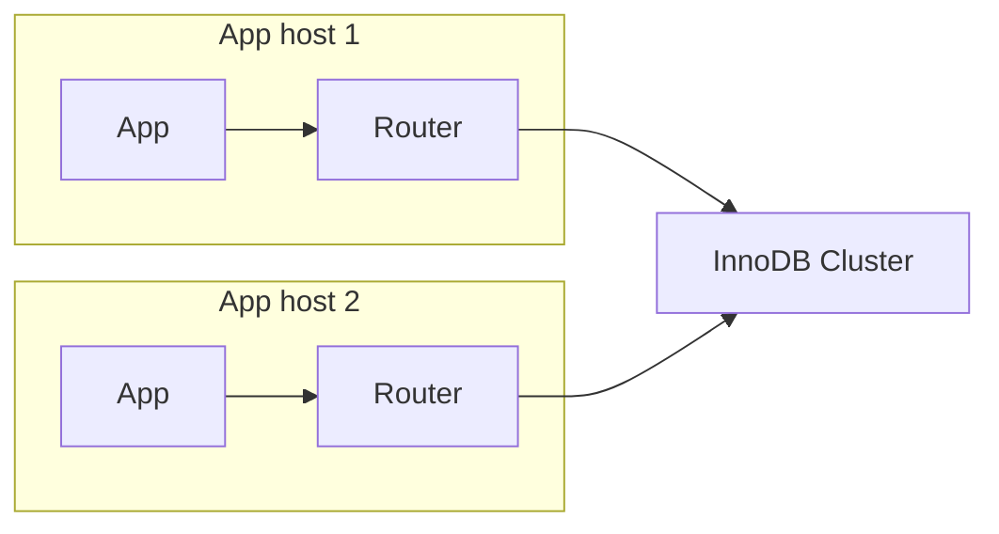
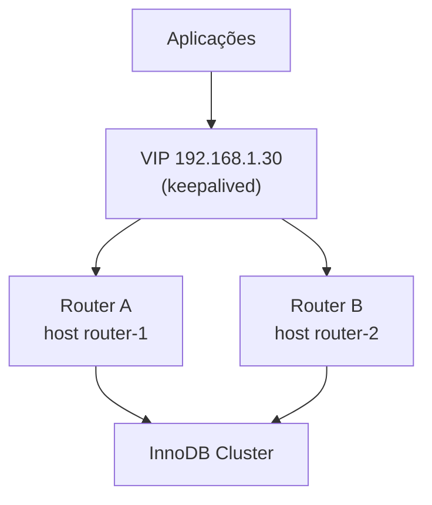

# MySQL InnoDB Cluster — Router redundante e VIP

O cluster de banco pode estar perfeito e a aplicação cair mesmo assim — se o **Router** for ponto único de falha. Este documento mostra como deixar a **camada do Router** também em alta disponibilidade. Config e estado reais do lab incluídos.

> Pré-leitura: `innodb-cluster-fundamentos-alta-disponibilidade.md` (seção do Router).

---

## Por que o Router pode ser o elo fraco

No lab, o Router roda **só no `mysql-db-01`**. Confirmando no metadata do cluster:

```
listRouters -> routers:
  "mysql-db-01::"  version=26.7.0  rwPort=6446 roPort=6447 ...
```

**Um único Router.** Se o host `mysql-db-01` cair inteiro, o Router cai junto — e aí não adianta o cluster de dados estar `OK`, porque a aplicação não tem por onde entrar. Em produção isso é inaceitável. A boa notícia: o Router é fácil de duplicar.

---

## A peça-chave: o Router é "stateless"

O Router **não guarda dados nem estado de cluster**. Ele só **lê o metadata** e acompanha o Group Replication. Veja na config real (o destino não é um IP fixo, é o metadata do cluster):

```ini
[routing:bootstrap_rw]
bind_port=6446
destinations=metadata-cache://labCluster/?role=PRIMARY
routing_strategy=first-available

[routing:bootstrap_ro]
bind_port=6447
destinations=metadata-cache://labCluster/?role=SECONDARY
routing_strategy=round-robin-with-fallback
```

Como ele não tem estado próprio, você pode rodar **quantos Routers quiser**, todos apontando para o mesmo cluster, de forma independente. Cada um descobre o PRIMARY sozinho. É isso que torna a HA do Router simples: **é só ter mais de um**.

### As estratégias de roteamento (config real)

| Porta | Papel do destino | Estratégia | O que faz |
|---|---|---|---|
| 6446 | `PRIMARY` | `first-available` | Sempre o primeiro PRIMARY disponível (a escrita) |
| 6447 | `SECONDARY` | `round-robin-with-fallback` | Reveza entre secundários; se não houver, cai no primário |
| 6450 | `PRIMARY_AND_SECONDARY` | `round-robin` | Read/Write split: distribui leitura, manda escrita ao primário |
| 6448 / 6449 | PRIMARY / SECONDARY (X Protocol) | — | Equivalente para o protocolo X |

---

## Padrão 1 (recomendado): um Router por aplicação

Instale o Router **junto de cada instância da aplicação** (mesmo host/pod). A aplicação conecta em `127.0.0.1:6446`.



Vantagens: **sem ponto único** (cada app tem o seu), **sem salto de rede extra**, escala junto com a aplicação. É a recomendação oficial para a maioria dos casos.

---

## Padrão 2: camada dedicada de Routers atrás de um VIP

Quando a aplicação não pode hospedar o Router (ou há muitos clientes), use **2+ Routers** em hosts dedicados, atrás de um **IP virtual (VIP)** gerenciado por `keepalived`, ou de um balanceador L4 (HAProxy, NLB da nuvem).



A aplicação conecta **no VIP**. Se o Router ativo cair, o `keepalived` move o VIP para o outro host, e a aplicação nem troca a string de conexão.

### Exemplo de `keepalived` (esqueleto)

No host do **Router A** (MASTER):

```
vrrp_script chk_router {
    script "/usr/bin/pidof mysqlrouter"
    interval 2
}
vrrp_instance VI_ROUTER {
    state MASTER
    interface eth0
    virtual_router_id 51
    priority 150
    virtual_ipaddress { 192.168.1.30/24 }
    track_script { chk_router }
}
```

No **Router B** (BACKUP): igual, com `state BACKUP` e `priority 100`. O `track_script` garante que o VIP só fica em um host com o `mysqlrouter` vivo.

---

## Como adicionar um segundo Router

Em um host novo (com o binário do Router instalado — ver o doc de instalação), faça o bootstrap apontando para o cluster. Ele se registra como um novo `router_id` no metadata, independente do primeiro:

```bash
sudo mysqlrouter --bootstrap clusteradmin@mysql-db-01:3306 \
  --directory /etc/mysqlrouter --user=mysqlrouter
sudo systemctl enable --now mysqlrouter
```

Depois, confira que os dois aparecem:

```bash
mysqlsh --uri clusteradmin@mysql-db-01:3306 --js \
  --execute="print(JSON.stringify(dba.getCluster().listRouters(), null, 2))"
```

> Cada Router cria sua própria conta de metadata (no lab: `mysql_router1_ak3cms8`). Vários Routers = várias contas `mysql_router*`. Isso é normal.

---

## Monitoração e limpeza

```bash
# Routers registrados e ultimo check-in
mysqlsh --uri clusteradmin@mysql-db-01:3306 --js \
  --execute="print(JSON.stringify(dba.getCluster().listRouters(), null, 2))"

# Remover do metadata um Router que foi desativado (evita lixo)
mysqlsh --uri clusteradmin@mysql-db-01:3306 --js \
  --execute="dba.getCluster().removeRouterMetadata('<hostname>::<nome>')"

# Saude local do Router
systemctl is-active mysqlrouter
sudo ss -ltnp | grep -E ':(6446|6447|6450|8443)'
```

O campo `lastCheckIn` do `listRouters()` diz quando cada Router falou com o cluster pela última vez — Router "mudo" há muito tempo é sinal de problema.

---

## Checklist de HA do Router

1. **Mais de um Router** servindo o cluster (`listRouters` mostra ≥ 2), ou um Router por aplicação.
2. Aplicação conecta num endereço **tolerante a falha**: `localhost` (padrão 1) ou **VIP/LB** (padrão 2) — nunca no IP fixo de um Router só.
3. `keepalived`/LB com **health check** que remove um Router morto do caminho.
4. Routers em **hosts diferentes** dos que você mais teme perder (idealmente não no mesmo host de um nó crítico).
5. `listRouters` sem entradas velhas (limpe com `removeRouterMetadata`).

---

## Não incluído neste documento

- Instalação passo a passo do Router (ver `innodb-cluster-single-primary-router.md`).
- Configuração completa de `keepalived`/HAProxy (unicast, autenticação VRRP, SELinux/firewall).
- Routing Guidelines avançadas (roteamento por tags/latência).
