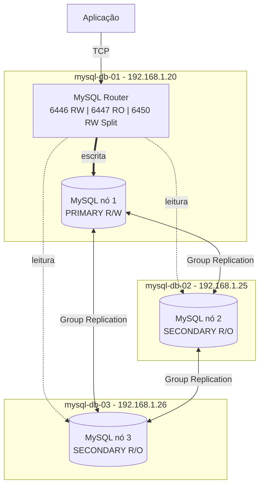

# MySQL InnoDB Cluster Single-Primary: 3 nós + MySQL Router

Cluster MySQL InnoDB Cluster no modo Single-Primary com 3 nós de dados e MySQL Router, que entrega uma porta de escrita (RW) e uma de leitura (RO) para a aplicação, com failover automático.

Procedimento validado em laboratório (VirtualBox). Siga na ordem.

## Topologia



Com 3 nós, o cluster mantém quórum (maioria) se 1 nó cair. A leitura (porta RO) é distribuída entre todos os secundários.

Neste laboratório o Router roda no mysql-db-01 por simplicidade. Em produção, instale-o junto da aplicação ou em hosts dedicados.

## Servidores

| Host | IP | Função |
|---|---|---|
| mysql-db-01 | 192.168.1.20 | MySQL (PRIMARY inicial), MySQL Shell, MySQL Router |
| mysql-db-02 | 192.168.1.25 | MySQL (SECONDARY) |
| mysql-db-03 | 192.168.1.26 | MySQL (SECONDARY) |

## Versões usadas

| Item | Versão |
|---|---|
| Ubuntu | 26.04.1 LTS (resolute) |
| MySQL Server | 9.7.4 LTS (`9.7.4-1ubuntu26.04`), repositório `repo.mysql.com/apt/ubuntu`, canal `mysql-9.7-lts` |
| MySQL Shell | 26.7.1 (tarball genérico `linux-glibc2.28`) |
| MySQL Router | 26.7.0 (tarball genérico `linux-glibc2.28`) |

Shell e Router **não** vêm do `apt` neste cenário. Veja o motivo na seção Observações. O Shell e o Router passaram a usar numeração `26.7.x`, mas funcionam com o servidor 9.7.4.

## Pré-requisitos

- 3 VMs Ubuntu 26.04.1 LTS com MySQL 9.7.4 instalado do repositório oficial da MySQL.
- IP fixo e hostname próprio em cada VM.
- VMs clonadas precisam de `machine-id` diferente. Confira nas 3: `cat /etc/machine-id`.
- Acesso `sudo` nas 3 VMs.
- Acesso à internet nas VMs, para baixar os tarballs do Shell e do Router.

Portas, só se o `ufw` estiver ativo:

| Porta | Uso | Servidores |
|---|---|---|
| 3306/tcp | MySQL e Group Replication | 01, 02, 03 |
| 33060/tcp | MySQL X Protocol (usado pelo Shell) | 01, 02, 03 |
| 6446/tcp | Router: clássico RW | Router |
| 6447/tcp | Router: clássico RO | Router |
| 6450/tcp | Router: Read/Write Split | Router |
| 6448/tcp e 6449/tcp | Router: X Protocol RW e RO | Router |
| 8443/tcp | Router: REST | Router |

Com `communicationStack = MYSQL` (padrão), o Group Replication usa a própria porta 3306 entre os membros. Não existe porta 33061 neste modo.

## Passo 1: conferir o `server_uuid` (01, 02 e 03)

VMs clonadas herdam o mesmo `server_uuid`, e o Group Replication não funciona assim.

```bash
sudo cat /var/lib/mysql/auto.cnf
hostnamectl --static
```

Resultado esperado: UUID **diferente** em cada nó. Se for igual, faça o Passo 2.

## Passo 2: reinicializar o datadir (01, 02 e 03)

Só faça isso em ambiente **sem dados**. Isso apaga tudo no MySQL.

```bash
sudo systemctl stop mysql
sudo rm -rf /var/lib/mysql/*
sudo mysqld --initialize-insecure --user=mysql
sudo systemctl start mysql
sudo cat /var/lib/mysql/auto.cnf
sudo mysql -e "SELECT @@hostname, @@version, @@server_uuid;"
```

Resultado esperado: versão `9.7.4` e UUID diferente em cada nó.

O `--initialize-insecure` cria o `root@localhost` sem senha. O acesso local com `sudo mysql` funciona, e o usuário administrador do cluster é criado no Passo 6.

## Passo 3: `/etc/hosts` (01, 02 e 03)

```bash
sudo sed -i '/^127\.0\.1\.1/d' /etc/hosts
grep -q 'mysql-db-01' /etc/hosts || sudo tee -a /etc/hosts <<'EOF'
192.168.1.20 mysql-db-01
192.168.1.25 mysql-db-02
192.168.1.26 mysql-db-03
EOF
cat /etc/hosts
getent hosts mysql-db-01 mysql-db-02 mysql-db-03
ping -c1 mysql-db-01; ping -c1 mysql-db-02; ping -c1 mysql-db-03
```

Resultado esperado: os 3 nomes resolvem para os IPs da tabela e o `ping` responde.

Remover a linha `127.0.1.1 <hostname>` é obrigatório. Com ela, o hostname resolve para loopback e o cluster registra o endereço errado.

## Passo 4: firewall (01, 02 e 03)

```bash
sudo ufw status
```

Se estiver `inactive`, não precisa fazer nada. Se estiver ativo:

```bash
sudo ufw allow from 192.168.1.0/24 to any port 3306,33060 proto tcp
```

## Passo 5: configuração do mysqld (01, 02 e 03)

**No mysql-db-01:**

```bash
sudo tee /etc/mysql/mysql.conf.d/99-innodb-cluster.cnf > /dev/null <<'EOF'
[mysqld]
bind-address             = 0.0.0.0
mysqlx-bind-address      = 0.0.0.0
server_id                = 1
report_host              = mysql-db-01
gtid_mode                = ON
enforce_gtid_consistency = ON
EOF
```

**No mysql-db-02:** o mesmo arquivo, com `server_id = 2` e `report_host = mysql-db-02`.

**No mysql-db-03:** o mesmo arquivo, com `server_id = 3` e `report_host = mysql-db-03`.

Nos 3 nós:

```bash
sudo systemctl restart mysql
sudo mysql -e "SELECT @@hostname, @@server_id, @@report_host, @@gtid_mode, @@bind_address;"
```

Resultado esperado: `server_id` 1, 2 e 3, `report_host` igual ao hostname, `gtid_mode = ON` e `bind_address = 0.0.0.0`.

O `server_id` e o `report_host` precisam ser únicos por nó.

## Passo 6: usuário administrador do cluster (01, 02 e 03)

Troque `SENHA_ADMIN` por uma senha sua. Ela precisa ser igual nos 3 nós.

```bash
sudo mysql <<'EOF'
SET sql_log_bin = 0;
CREATE USER 'clusteradmin'@'%' IDENTIFIED BY 'SENHA_ADMIN';
GRANT ALL PRIVILEGES ON *.* TO 'clusteradmin'@'%' WITH GRANT OPTION;
SET sql_log_bin = 1;
EOF

sudo mysql -e "SELECT user, host FROM mysql.user WHERE user='clusteradmin'; SELECT @@global.gtid_executed AS gtid_executed;"
```

Resultado esperado: o usuário `clusteradmin@%` existe e `gtid_executed` está **vazio**.

O `sql_log_bin = 0` evita criar GTIDs diferentes em cada nó (GTIDs errantes). Em produção, restrinja os privilégios do `clusteradmin`.

## Passo 7: instalar o MySQL Shell (01)

O Shell só precisa existir em um host. Aqui, no mysql-db-01.

```bash
cd /tmp
curl -fLO https://cdn.mysql.com/Downloads/MySQL-Shell/mysql-shell-26.7.1-linux-glibc2.28-x86-64bit.tar.gz
sudo tar -xzf mysql-shell-26.7.1-linux-glibc2.28-x86-64bit.tar.gz -C /opt
sudo ln -sfn /opt/mysql-shell-26.7.1-linux-glibc2.28-x86-64bit /opt/mysql-shell
sudo ln -sf /opt/mysql-shell/bin/mysqlsh /usr/local/bin/mysqlsh
hash -r
mysqlsh --version
```

Resultado esperado: `mysqlsh Ver 26.7.1 ... for MySQL 26.7.0`.

Se o pacote `mysql-shell` do Ubuntu (8.4.8) já foi instalado, remova antes:

```bash
sudo apt remove -y mysql-shell
```

Os links do CDN podem mudar com novas versões. Confira em https://dev.mysql.com/downloads/shell/.

## Passo 8: validar e preparar as instâncias (01)

Abra o Shell no mysql-db-01. Ele pede a senha do `clusteradmin`.

```bash
mysqlsh
```

Dentro do Shell (modo JavaScript):

```js
\js
dba.checkInstanceConfiguration('clusteradmin@mysql-db-01:3306')
dba.checkInstanceConfiguration('clusteradmin@mysql-db-02:3306')
dba.checkInstanceConfiguration('clusteradmin@mysql-db-03:3306')
```

Resultado esperado, para cada nó: `Instance configuration is compatible with InnoDB cluster` e `"status": "ok"`.

Depois persista a configuração:

```js
dba.configureInstance('clusteradmin@mysql-db-01:3306')
dba.configureInstance('clusteradmin@mysql-db-02:3306')
dba.configureInstance('clusteradmin@mysql-db-03:3306')
```

Resultado esperado: `Successfully enabled parallel appliers.` em cada nó, sem pedir reinício.

## Passo 9: criar o cluster (01)

No mesmo `mysqlsh`:

```js
shell.connect('clusteradmin@mysql-db-01:3306')
var cluster = dba.createCluster('labCluster')
cluster.status()
```

Resultado esperado: 1 nó `PRIMARY`, `R/W`, `ONLINE`, `"status": "OK_NO_TOLERANCE"` e `"topologyMode": "Single-Primary"`.

Não use a opção `ipAllowlist`. Com `communicationStack = MYSQL` ela gera o erro `Cannot use 'ipAllowlist' when the 'communicationStack' is 'MYSQL'`.

## Passo 10: adicionar os nós 02 e 03 (01)

No mesmo `mysqlsh`:

```js
cluster.addInstance('clusteradmin@mysql-db-02:3306', {recoveryMethod: 'clone'})
cluster.addInstance('clusteradmin@mysql-db-03:3306', {recoveryMethod: 'clone'})
var cluster = dba.getCluster('labCluster')
cluster.status()
```

Durante o `clone`, o nó novo apaga os dados locais, copia do primário e **reinicia sozinho**.

Se o Shell mostrar `Waiting for server restart... timeout` e `Unable to stop Group Replication ... Lost connection`, o nó provavelmente voltou depois do timeout. Confirme que o MySQL está ativo no nó e rode:

```js
var cluster = dba.getCluster('labCluster')
cluster.rescan()
cluster.status()
```

Responda `Y` quando o `rescan()` perguntar se deve adicionar o nó ao metadata.

Resultado esperado final: 3 nós `ONLINE`, `"status": "OK"`, `"statusText": "Cluster is ONLINE and can tolerate up to ONE failure."` e nenhum `instanceErrors`.

## Passo 11: instalar o MySQL Router (01)

```bash
cd /tmp
curl -fLO https://cdn.mysql.com/Downloads/MySQL-Router/mysql-router-26.7.0-linux-glibc2.28-x86_64.tar.xz
sudo tar -xJf mysql-router-26.7.0-linux-glibc2.28-x86_64.tar.xz -C /opt
sudo ln -sfn /opt/mysql-router-26.7.0-linux-glibc2.28-x86_64 /opt/mysql-router
sudo ln -sf /opt/mysql-router/bin/mysqlrouter /usr/local/bin/mysqlrouter
hash -r
mysqlrouter --version
id mysqlrouter || sudo useradd -r -s /usr/sbin/nologin mysqlrouter
```

Resultado esperado: `MySQL Router Ver 26.7.0` e o usuário `mysqlrouter` criado.

## Passo 12: bootstrap do Router (01)

Digite a senha do `clusteradmin` quando pedir.

```bash
sudo mysqlrouter --bootstrap clusteradmin@mysql-db-01:3306 --directory /etc/mysqlrouter --user=mysqlrouter
```

Resultado esperado: a mensagem `MySQL Router configured for the InnoDB Cluster 'labCluster'` e a lista de portas (6446, 6447, 6450, 6448, 6449).

O bootstrap cria `/etc/mysqlrouter/` com `mysqlrouter.conf`, `mysqlrouter.key`, `data/`, `log/`, `run/`, `start.sh` e `stop.sh`.

## Passo 13: serviço systemd do Router (01)

O tarball não traz unit do systemd. Crie uma:

```bash
sudo tee /etc/systemd/system/mysqlrouter.service > /dev/null <<'EOF'
[Unit]
Description=MySQL Router
After=network-online.target mysql.service
Wants=network-online.target

[Service]
Type=simple
User=mysqlrouter
Group=mysqlrouter
ExecStart=/opt/mysql-router/bin/mysqlrouter -c /etc/mysqlrouter/mysqlrouter.conf
Restart=on-failure
LimitNOFILE=10000

[Install]
WantedBy=multi-user.target
EOF

sudo systemctl daemon-reload
sudo systemctl enable --now mysqlrouter
sleep 3
sudo systemctl status mysqlrouter --no-pager | head -n 12
sudo ss -ltnp | grep mysqlrouter
```

Resultado esperado: serviço `active (running)` e as portas 6446, 6447, 6448, 6449, 6450 e 8443 em `LISTEN`.

## Passo 14: usuário da aplicação e teste de escrita (01)

Troque `SENHA_APP` por uma senha sua. Conecte pelo Router, na porta de escrita:

```bash
mysql -h 127.0.0.1 -P 6446 -u clusteradmin -p
```

Dentro do cliente:

```sql
SELECT @@hostname, @@read_only;
CREATE DATABASE appdb;
CREATE USER 'app'@'%' IDENTIFIED BY 'SENHA_APP';
GRANT ALL ON appdb.* TO 'app'@'%';
CREATE TABLE appdb.teste (id INT AUTO_INCREMENT PRIMARY KEY, host VARCHAR(50), ts TIMESTAMP DEFAULT CURRENT_TIMESTAMP);
INSERT INTO appdb.teste (host) VALUES (@@hostname);
SELECT * FROM appdb.teste;
```

Resultado esperado: `@@hostname = mysql-db-01`, `@@read_only = 0` e a linha inserida aparece no `SELECT`.

## Passo 15: teste de leitura pelo Router (01)

```bash
for i in 1 2 3 4; do mysql -h 127.0.0.1 -P 6447 -u app -p'SENHA_APP' -N -e "SELECT @@hostname, @@read_only;" 2>/dev/null; done
mysql -h 127.0.0.1 -P 6447 -u app -p'SENHA_APP' -e "INSERT INTO appdb.teste (host) VALUES ('x');"
mysql -h 127.0.0.1 -P 6446 -u app -p'SENHA_APP' -N -e "SELECT * FROM appdb.teste;" 2>/dev/null
```

Resultado esperado:

- A porta 6447 alterna entre `mysql-db-02` e `mysql-db-03`, sempre com `read_only = 1`.
- O `INSERT` na 6447 falha com `ERROR 1290 ... --read-only option`.
- A porta 6446 mostra a linha inserida no Passo 14, já replicada.

## Passo 16: teste de failover (01)

Derrube o primário. **No mysql-db-01:**

```bash
sudo systemctl stop mysql
```

Veja o novo estado, ainda no mysql-db-01 (o Shell conecta no db-02):

```bash
mysqlsh clusteradmin@mysql-db-02:3306 --js -e "print(JSON.stringify(dba.getCluster('labCluster').status().defaultReplicaSet, null, 2))"
```

Resultado esperado: `mysql-db-02` vira `PRIMARY` `R/W`, `mysql-db-01` fica `(MISSING)` e o status do cluster é `OK_NO_TOLERANCE_PARTIAL`.

Escrita e leitura pelo Router continuam funcionando, sem trocar a string de conexão:

```bash
mysql -h 127.0.0.1 -P 6446 -u app -p'SENHA_APP' -e "SELECT @@hostname, @@read_only; INSERT INTO appdb.teste (host) VALUES (@@hostname); SELECT * FROM appdb.teste;" 2>/dev/null
for i in 1 2 3; do mysql -h 127.0.0.1 -P 6447 -u app -p'SENHA_APP' -N -e "SELECT @@hostname, @@read_only;" 2>/dev/null; done
```

Resultado esperado: a escrita cai em `mysql-db-02`, os dados anteriores continuam lá e a leitura só responde `mysql-db-03`.

Se a primeira conexão falhar logo após a queda, repita. O Router leva alguns segundos para atualizar a topologia.

## Passo 17: retorno automático do nó (01)

Religue o MySQL no mysql-db-01:

```bash
sudo systemctl start mysql
sleep 60
mysqlsh clusteradmin@mysql-db-02:3306 --js -e "print(JSON.stringify(dba.getCluster('labCluster').status().defaultReplicaSet.topology, null, 2))"
```

Resultado esperado: `mysql-db-01` volta sozinho como `SECONDARY` `R/O` `ONLINE`, sem nenhuma intervenção. O cluster volta a `"status": "OK"` com 3 nós.

## Passo 18: switchover planejado (01)

Devolve o papel de PRIMARY ao mysql-db-01, sem falha:

```bash
mysqlsh clusteradmin@mysql-db-02:3306 --js -e "dba.getCluster('labCluster').setPrimaryInstance('clusteradmin@mysql-db-01:3306'); print(JSON.stringify(dba.getCluster('labCluster').status().defaultReplicaSet.topology, null, 2))" | grep -E '"(mysql-db|memberRole|mode|status)'
```

Resultado esperado: `mysql-db-01` `PRIMARY` `R/W`, `mysql-db-02` e `mysql-db-03` `SECONDARY` `R/O`, todos `ONLINE`.

## Observações

- **Shell e Router fora do apt:** o pacote `mysql-shell` do Ubuntu 26.04 é a série 8.4.8, incompatível com o servidor 9.7. O repositório da MySQL não publica Shell nem Router para `resolute`. O `.deb` do `noble` falha com `Depends: libpython3.12t64 ... not installable`. Por isso usamos os tarballs genéricos.
- **Numeração:** os tarballs com versão `9.7.x` retornam 404. Os arquivos atuais usam `26.7.x`. Para o Router, existia a 26.7.0 (`.tar.xz`), mas não a 26.7.1.
- **Ubuntu `mysql-router`:** o pacote do Ubuntu é 8.4.x, também fora da série do servidor.
- **VMs lentas no clone:** o restart após o clone pode passar do timeout do Shell. O MySQL volta sozinho; o `rescan()` corrige o metadata. Opcional (não testado): `shell.options["dba.restartWaitTimeout"] = 300` antes do `addInstance`.
- **Modo do Shell:** o `mysqlsh` tem modos JS e SQL. Comandos como `cluster.status()` só funcionam em JS (`\js`). Comandos de bash colados dentro do Shell dão `SyntaxError`; saia com `\q` antes.
- **Router no mysql-db-01:** se a VM inteira do db-01 cair, o Router cai junto. Nos testes foi parado só o serviço `mysql`, e o Router continuou de pé. Em produção, use um host separado ou mais de um Router.
- **Router escuta em `0.0.0.0`:** no bootstrap as portas aparecem como `localhost`, mas o `ss` mostra `0.0.0.0`. Restrinja com firewall se necessário.
- **Aviso do cliente:** `Using a password on the command line interface can be insecure` aparece ao usar `-p'SENHA'`. Não afeta o resultado.
- **Logs do MySQL:** `/var/log/mysql/error.log` e `journalctl -u mysql`.
- **Logs do Router:** `/etc/mysqlrouter/log/` e `journalctl -u mysqlrouter`.
- **Senhas:** as senhas deste documento são placeholders. Em produção, use senhas fortes e restrinja os privilégios do `clusteradmin`.

## Comandos úteis

```bash
# Estado do cluster
mysqlsh clusteradmin@mysql-db-01:3306 --js -e "print(JSON.stringify(dba.getCluster('labCluster').status(), null, 2))"

# Estado do Group Replication (dentro do mysql)
sudo mysql -e "SELECT member_host, member_state, member_role FROM performance_schema.replication_group_members;"

# Quem está respondendo em cada porta do Router
mysql -h 127.0.0.1 -P 6446 -u app -p -N -e "SELECT @@hostname;"
mysql -h 127.0.0.1 -P 6447 -u app -p -N -e "SELECT @@hostname;"

# Serviços e portas
systemctl is-active mysql mysqlrouter
sudo ss -ltnp | grep -E 'mysqld|mysqlrouter'

# Logs
sudo journalctl -u mysql -n 50 --no-pager
sudo journalctl -u mysqlrouter -n 50 --no-pager
sudo tail -n 50 /var/log/mysql/error.log
```

## Não incluído neste documento

- Recuperação de queda total do cluster (`dba.rebootClusterFromCompleteOutage()`).
- Perda de quórum (2 nós fora ao mesmo tempo).
- Desligamento e inicialização ordenados do ambiente.
- Router redundante ou com IP virtual (VIP).
- Backup e restore.
- TLS com certificados próprios.
- Atualização de versão do servidor, Shell e Router.
