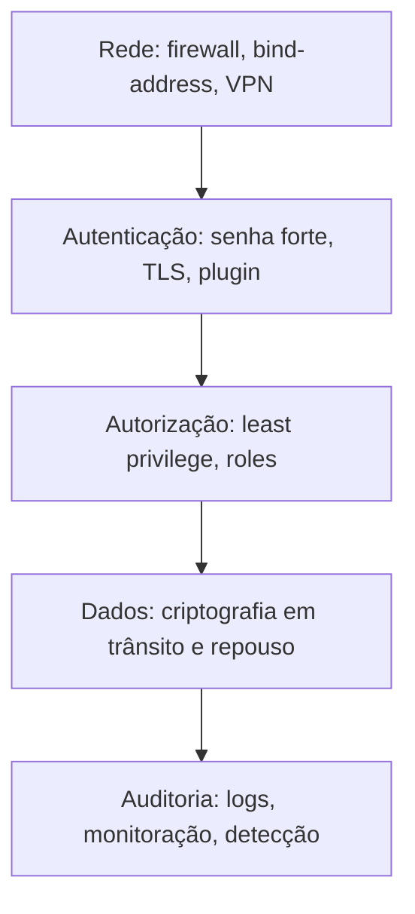

# MySQL Security — Fundamentos e Hardening

Base da subpasta de segurança. Modelo de defesa em camadas, superfície de ataque e um **checklist de hardening** com a auditoria real da configuração do lab (MySQL 9.7.4).

> Esta é a porta de entrada. Os docs específicos (privilégios, autenticação, privilege escalation, TLS, SQL injection, auditoria) partem daqui.

---

## Defesa em camadas (defense in depth)

Nenhum controle sozinho protege o banco. Pense em camadas, de fora para dentro:



Se uma camada falhar, a próxima ainda segura. Um atacante que roube uma senha não deve conseguir ler `/etc/passwd`; quem entre num nó não deve ver tráfego em texto puro.

---

## Superfície de ataque do MySQL

| Vetor | Risco | Onde tratamos |
|---|---|---|
| Rede exposta | Acesso de qualquer IP | `bind-address` + firewall (este doc) |
| Contas fracas / sem senha | Login trivial | `security-autenticacao-senhas.md` |
| Privilégios excessivos | Um vazamento vira desastre | `security-usuarios-privilegios.md` |
| `FILE` / `secure_file_priv` | Ler/escrever arquivos do SO | `security-privilege-escalation.md` |
| Tráfego sem TLS | Sniffing de credenciais/dados | `security-tls-criptografia.md` |
| SQL injection (app) | Vazamento/alteração de dados | `security-sql-injection.md` |
| Falta de auditoria | Ataque sem rastro | `security-auditoria-logging.md` |

---

## Auditoria real da config do lab

Variáveis de segurança lidas do servidor (MySQL 9.7.4):

| Variável | Valor no lab | Avaliação |
|---|---|---|
| `bind_address` / `mysqlx_bind_address` | `0.0.0.0` | ⚠️ escuta em todas as interfaces → depende de **firewall** |
| `local_infile` | `OFF` | ✅ bom (evita abuso de `LOAD DATA LOCAL`) |
| `secure_file_priv` | `/var/lib/mysql-files/` | ✅ bom (FILE restrito a um diretório) |
| `skip_name_resolve` | `OFF` | ⚠️ grants por hostname dependem de DNS (spoofável) |
| `require_secure_transport` | `OFF` | ⚠️ TLS **não** obrigatório |
| `sql_mode` | `STRICT_TRANS_TABLES,...` | ✅ strict mode ligado |
| `validate_password` (componente) | **não instalado** | ⚠️ sem política de senha |
| `general_log` | `OFF` | ✅ (ligar só para auditoria pontual) |
| `log_error` | `/var/log/mysql/error.log` | ✅ |
| TLS disponível | `ssl_ca/cert/key` presentes, TLSv1.2+1.3 | ✅ TLS pronto (certos auto-gerados) |

**Resumo:** a base está razoável (local_infile off, secure_file_priv restrito, strict mode), mas há 4 pontos a endurecer: **firewall para o `0.0.0.0`**, **tornar TLS obrigatório**, **instalar política de senha**, e **`skip_name_resolve`**.

---

## Checklist de hardening

### Rede
- [ ] **Firewall** liberando 3306/33060 só para os IPs necessários (app, nós do cluster). O `bind-address=0.0.0.0` é exigido pelo Group Replication, então a proteção é no firewall.
- [ ] `skip_name_resolve = ON` — usa só IP nos grants (evita spoofing de DNS e é mais rápido):
```ini
[mysqld]
skip_name_resolve = ON
```

### Contas e privilégios
- [ ] Nenhuma conta **sem senha** (ver o `root@localhost` do lab — doc de autenticação).
- [ ] Nenhuma conta **anônima** (`user=''`) e sem o banco `test`.
- [ ] **Least privilege**: ninguém com `ALL ON *.*` que não precise (doc de privilégios).
- [ ] Hosts específicos em vez de `%` sempre que possível.

### Autenticação
- [ ] `caching_sha2_password` (padrão no lab — ✅, melhor que `mysql_native_password`).
- [ ] Instalar **`validate_password`** e definir expiração/histórico (doc de autenticação).

### Criptografia
- [ ] `require_secure_transport = ON` (TLS obrigatório) ou `REQUIRE SSL` por conta (doc de TLS).
- [ ] Avaliar **criptografia em repouso** (keyring + tablespace encryption).

### Sistema de arquivos / RCE
- [ ] `secure_file_priv` apontando para um diretório restrito (✅ no lab) — **nunca vazio**.
- [ ] `local_infile = OFF` (✅ no lab).

### Auditoria
- [ ] Plugin de auditoria (Percona/MariaDB audit) ou pelo menos tracking de conexões (doc de auditoria).
- [ ] Monitorar falhas de login e acessos privilegiados.

> **`mysql_secure_installation`:** em instalações novas, rode este assistente — ele remove usuários anônimos, bloqueia root remoto, remove o banco `test` e opcionalmente instala a política de senha. Faz boa parte deste checklist de uma vez.

---

## Plugins e ferramentas que agregam (camada de aplicação)

O hardening do **servidor** é feito aqui. Para o código das **aplicações** que falam com o banco (onde mora o SQL injection), valem ferramentas de auditoria de código:

- **`/security-review`** (comando nativo do Claude Code): audita o diff atual em busca de vulnerabilidades.
- **OWASP Security Audit**, **Spec Security Review**, **Security Audit Loop** (plugins do diretório): SAST/SCA, OWASP Top 10, autorização, supply-chain — úteis para revisar o código das apps antes de confiar que a query é segura.

Eles **não** substituem o hardening do banco; são a camada de aplicação do defense-in-depth.

---

## Documentos desta subpasta

1. Fundamentos e hardening (este)
2. `security-usuarios-privilegios.md`
3. `security-autenticacao-senhas.md`
4. `security-privilege-escalation.md`
5. `security-tls-criptografia.md`
6. `security-sql-injection.md`
7. `security-auditoria-logging.md`
