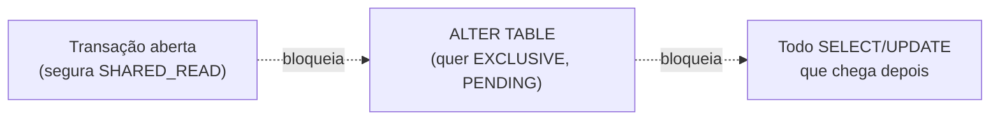

# MySQL Troubleshooting — Metadata locks (DDL travado)

O caso "meu `ALTER TABLE` ficou preso em *Waiting for table metadata lock*" — e, pior, travou **todo mundo** que mexe naquela tabela. Explica o metadata lock (MDL), como diagnosticar e como liberar. Com experimento real no lab.

> Pré-leitura: `troubleshooting-locks-fundamentos.md`.

---

## O que é um metadata lock (MDL)

Além de travar **linhas**, o MySQL trava a **estrutura** da tabela. Isso evita que um `ALTER` mude a tabela no meio de uma transação que está lendo/escrevendo nela.

- Qualquer DML (`SELECT`, `INSERT`, `UPDATE`...) pega um MDL **compartilhado** (`SHARED_READ`/`SHARED_WRITE`) na tabela e **o segura até a transação terminar** (`COMMIT`/`ROLLBACK`).
- DDL (`ALTER`, `DROP`, `RENAME`, `TRUNCATE`) precisa de um MDL **exclusivo** (`EXCLUSIVE`).
- Exclusivo e compartilhado não convivem → o DDL **espera** toda transação aberta que tocou a tabela.

### Por que isso é tão perigoso: o efeito cascata

Quando o `ALTER` entra na fila esperando o lock exclusivo, **ele fica à frente** de todas as queries seguintes. A partir daí, **até um `SELECT` simples** naquela tabela entra na fila atrás do `ALTER`. Resultado: uma transação esquecida aberta + um `ALTER` = **a tabela inteira congela** para a aplicação. É um dos incidentes mais comuns e assustadores em produção.



---

## Reproduzindo

| Tempo | Sessão A | Sessão B |
|---|---|---|
| t0 | `BEGIN; SELECT COUNT(*) FROM contas;` (não commita) | |
| t2 | | `ALTER TABLE contas ADD COLUMN obs VARCHAR(10);` → **trava** |

Enquanto a transação A estiver aberta, o `ALTER` não sai do lugar.

---

## Diagnóstico

### 1. `PROCESSLIST` — o estado denuncia

```sql
SELECT ID, TIME, STATE, LEFT(INFO,40) AS query
FROM information_schema.PROCESSLIST
WHERE STATE LIKE '%metadata%';
```

Saída real:

```
| conn | seg | estado                          | query                             |
|  725 |   3 | Waiting for table metadata lock | ALTER TABLE tshoot.contas ADD ... |
```

O estado **`Waiting for table metadata lock`** é a assinatura do problema.

### 2. `performance_schema.metadata_locks` — quem segura o quê

```sql
SELECT OBJECT_TYPE, OBJECT_NAME, LOCK_TYPE, LOCK_STATUS, OWNER_THREAD_ID
FROM performance_schema.metadata_locks
WHERE OBJECT_SCHEMA = 'tshoot';
```

Saída **real** (anotada):

```
| tipo   | objeto       | lock_type           | status  | thread |
| TABLE  | contas       | SHARED_READ         | GRANTED |   767  |  <- A: transacao aberta segura isto
| SCHEMA | NULL         | INTENTION_EXCLUSIVE | GRANTED |   768  |  <- B (o ALTER)
| TABLE  | contas       | SHARED_UPGRADABLE   | GRANTED |   768  |  <- B comecou o ALTER
| TABLE  | #sql-52a_2d5 | EXCLUSIVE           | GRANTED |   768  |  <- tabela temporaria do ALTER
| TABLE  | contas       | EXCLUSIVE           | PENDING |   768  |  <- B ESPERA por isto
```

Leia assim: a thread **767** tem `SHARED_READ GRANTED` em `contas` (é a transação esquecida). A thread **768** (o `ALTER`) tem um `EXCLUSIVE PENDING` — está esperando. **O vilão é a thread 767.**

### 3. Traduzir a thread em conexão (para poder matar)

O `OWNER_THREAD_ID` é o id interno do `performance_schema`, **não** o id de conexão do `KILL`. Converta:

```sql
SELECT PROCESSLIST_ID
FROM performance_schema.threads
WHERE THREAD_ID = 767;
```

O `PROCESSLIST_ID` retornado é o número que você usa no `KILL`.

---

## Resolver

O certo é **terminar a transação que segura o `SHARED`** — idealmente a própria aplicação commitando. Se ela está esquecida/ociosa e você precisa liberar:

```sql
KILL <PROCESSLIST_ID_da_thread_767>;
```

Assim que a transação A encerra, o `ALTER` **pega o lock e conclui na hora**. No lab, após a Sessão A commitar, o `ALTER` terminou e a coluna entrou:

```
colunas agora: id, obs, saldo, titular
```

> **Não mate o `ALTER`** achando que é ele o problema — ele é a vítima. Mate a **transação que o bloqueia** (a que segura o `SHARED`).

---

## A variável que deixa o `ALTER` pendurado para sempre

O timeout de metadata lock é o `lock_wait_timeout` — e o padrão é **31536000 s (1 ano)**. Ou seja, por padrão o `ALTER` espera "infinito", segurando a cascata junto.

```sql
SELECT @@lock_wait_timeout;
```

**Boa prática:** antes de rodar DDL, baixe o timeout **só na sua sessão**, para o `ALTER` **falhar rápido** em vez de congelar a tabela:

```sql
SET SESSION lock_wait_timeout = 10;   -- se nao conseguir o lock em 10s, falha e nao trava ninguem
ALTER TABLE contas ADD COLUMN ...;
```

---

## Prevenção

- **DDL em janela de manutenção**, com a certeza de que **não há transações longas abertas**.
- **Antes do `ALTER`**, cheque transações abertas: `SELECT * FROM information_schema.innodb_trx ORDER BY trx_started;`
- **`SET SESSION lock_wait_timeout` baixo** na sessão de DDL (acima) — evita a cascata.
- **DDL online** para tabelas grandes/quentes: `ALGORITHM=INPLACE, LOCK=NONE` quando a operação suportar, ou ferramentas como `pt-online-schema-change` / `gh-ost`, que fazem a mudança sem segurar o exclusivo o tempo todo.
- **Mate transações ociosas** (a causa raiz é quase sempre uma app que não commitou).

---

## Comandos úteis

```sql
-- Achar DDL preso
SELECT ID, TIME, STATE, LEFT(INFO,60) FROM information_schema.PROCESSLIST
WHERE STATE LIKE '%metadata%';

-- Quem segura o MDL da tabela
SELECT OBJECT_NAME, LOCK_TYPE, LOCK_STATUS, OWNER_THREAD_ID
FROM performance_schema.metadata_locks WHERE OBJECT_SCHEMA='<schema>';

-- Thread -> conexao
SELECT PROCESSLIST_ID FROM performance_schema.threads WHERE THREAD_ID=<owner_thread_id>;

-- Liberar (matar a transacao que segura o SHARED)
KILL <processlist_id>;
```

---

## Não incluído neste documento

- Bloqueio de linhas e `KILL` — `troubleshooting-bloqueios-lock-waits.md`.
- Deadlocks — `troubleshooting-deadlocks.md`.
- DDL online detalhado (INPLACE × INSTANT × COPY) e uso de `gh-ost`/`pt-osc`.
